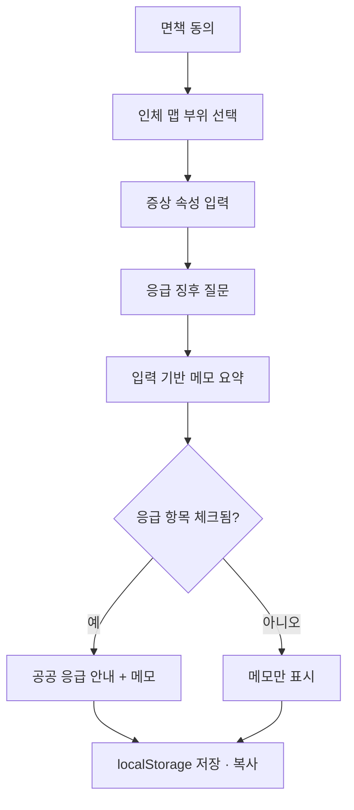

# 어디아파 · 의료 길찾기 MVP (법 안전 우선 · 광고 수익)

> **한 줄 포지션**: 진단이 아닌 **의료 길찾기**.  
> BODY → SYMPTOM → SAFETY GUIDE → DEPARTMENT → SYMPTOM SUMMARY  
> 질병명·확률·치료·약 처방·응급 확정 판정은 하지 않는다.  
> 진료과는 **「일반적으로 상담하는 과」** 참고 정보로만 안내한다. 병원/의사/영양제 추천은 하지 않는다.  
> **수익은 광고만** (§8). 구독·유료 기능 없음.

> **구현 현황 (2026-10-11)**: `web/` (Next.js 16 · TypeScript · Tailwind) 에 MVP 구현.  
> 실행·구조는 `web/README.md`. 아래 §1~§7 중 「메모 전용」 서술은 이 구현(진료과 안내 포함)으로 대체됨.

## 0. 법 안전 원칙 (절대)

| 원칙 | 내용 |
|------|------|
| 의료행위 아님 | 질병 진단·치료·경감·예방을 **목적·기능·문구**로 표방하지 않음 |
| 결정 대체 금지 | 「어디 과」「병원 갈지」「약 먹을지」를 **판단·추천하지 않음** |
| 응급만 공공 안내 | red flag 해당 시에만 **119·응급실** 등 **공공 응급 안내** (교육 목적). 알고리즘 진단 아님 |
| 그 외 결과 | **메모·요약만**. 행동 선택지(약국/관찰/당일진료) 카드 **없음** |
| 금지 영역 | 약·영양제·검사 해석·의사/병원 랭킹·LLM 진료 권고 |
| 출시 전 | 식약처 **의료기기 해당여부** 민원 + 변호사 문구 검토 (프로토타입 단계도 동일 톤 유지) |

**제품 카피**: 「진료 전, 내 증상 정리하기」  
**금지 카피**: 「증상 체크」「어디가 아픈지 알려드립니다」「이 과는 ○○」

## 1. 제품 이름 (가칭)

- 작업명: **증상기록** (`prototype/symptom-log`)
- UI 타이틀: **진료용 증상 메모**

## 2. 프로토타입(B) — 이번에 할 것

| 기능 | 설명 |
|------|------|
| 면책 동의 | 시작 전 필수. 미동의 시 진행 불가 |
| 인체 맵 | 2D SVG. 머리·가슴·배·팔·다리 선택 |
| 증상 속성 | 통증 종류, 강도, 시작일, 악화·완화, 동반 체크 |
| 응급 징후 질문 | 예/아니오. **기록용 질문** + 해당 시 공공 응급 안내만 |
| 요약 | 진료 시 붙여넣을 **텍스트 메모** + 복사 |
| 기록함 | 브라우저 `localStorage` (서버·DB 없음) |

## 3. 하지 않을 것 (이번·v1 공통)

- 병원 vs 약국 vs 관찰 **추천**
- 진료과·의사·영양제·약 추천
- 검사 해석, AI 진단
- 「의료기기」「증상 체커」 표현

## 4. 표현 가드레일 (UI 고정)

- 모든 화면 footer:  
  `이 서비스는 의료 행위·진단이 아니며, 의사 진료를 대체하지 않습니다. 응급이 의심되면 119에 연락하세요.`
- 결과(비응급):  
  `아래는 대표님이 입력하신 내용을 정리한 메모입니다. 진료 시 참고용으로 보여 주세요.`
- 결과(응급 징후 해당):  
  `입력하신 내용 중 응급 상황에서 흔히 주의하는 항목이 포함되어 있습니다. 즉시 119 또는 가까운 응급실로 연락·방문하시기 바랍니다. 본 안내는 진단이 아닙니다.`
- red flag **미해당**이어도 「괜찮다」「약국만」 같은 안심·추천 문구 **금지**

## 5. 사용자 플로우



## 6. 화면

1. 온보딩·면책 동의  
2. 부위 선택 (SVG)  
3. 증상 상세  
4. 응급 징후 질문  
5. 요약 (+ 해당 시 응급 안내)  
6. 기록함  

## 7. 프로토타입 기술

- 경로: `prototype/symptom-log/`
- 정적 HTML/CSS/JS (빌드 없음, 브라우저로 바로 확인)
- 모듈: `body-map`, `symptom-form`, `red-flag`, `summary`, `storage`
- 데이터: 부위 코드 + red flag 질문 JSON (서버 없음)

## 8. 수익 모델 — 광고 (대표님 확정)

구독·유료 없음. **광고 수익 = 페이지뷰 × 광고 단가(RPM)** 이므로 제품을 「도구」가 아니라 **트래픽이 쌓이는 건강정보 사이트 + 인체맵 도구**로 구성한다.

### 8.1 수익 구조 (예상치, 한국 기준)

| 채널 | 내용 | 비고 |
|------|------|------|
| Google AdSense | 디스플레이·인콘텐츠 광고 | 건강 분야 RPM 대략 ₩2,000~8,000/1,000PV. 승인에 **원본 콘텐츠·개인정보처리방침·운영자 정보** 필요 |
| Kakao AdFit | 모바일 배너 | 단가 낮음, 보조 |
| 쿠팡 파트너스 등 제휴 | 일반 건강용품·가정상비 카테고리 링크 | **「이 증상엔 이 제품」 연결 금지**. 「광고」표기 필수 |
| 직접 광고 (후기) | 트래픽 확보 후 | 의료기관 광고는 §8.4 규제 확인 후 |

**목표 감각**: 월 ₩300만 광고 수익 ≈ 월 **50만~150만 PV** 필요. 도구 1페이지로는 불가능 → **콘텐츠 페이지 수백 개**가 전제.

### 8.2 제품 구조 변경

```
[검색 유입]  부위×증상 정보 페이지 (수백 개)  ← 광고 노출의 본체
      ↓ 내부 링크
[체류·재방문]  인체맵 도구 → 메모 → 기록함     ← 차별 포인트·재방문 동기
      ↓
[광고 지면]  정보 페이지 본문 중간 / 결과 화면 하단 / 기록함
```

- **정보 페이지 템플릿** (예: `/body/abdomen/left-lower-pain`)
  - 제목: 「왼쪽 아랫배 통증, 사람들이 흔히 적는 특징」
  - 구성: 일반 건강정보(교과서·공공 자료 인용) → 「진료 시 이렇게 말하면 도움」 → **인체맵에서 기록하기 CTA** → 응급 징후 공공 안내 → 출처·감수자·면책
  - **진단·과 지정·약 추천 없음** (톤은 §0 그대로)
- **인체맵 도구**: 지금 프로토타입 유지. 결과 화면에 **관련 정보 페이지 링크** + 광고 지면 1~2개
- **기록함**: 재방문 트래픽. 로그인 없이 localStorage 유지 → 나중에 선택 가입

### 8.3 트래픽 전략

| 순서 | 내용 |
|------|------|
| 1 | 부위 6 × 증상 유형 5~8 × 상황(기간·동반증상) = **초기 100~200 페이지** 템플릿 생성 |
| 2 | Google 검색: 롱테일 키워드(「오른쪽 옆구리 뻐근 며칠」) 중심. 사이트맵·구조화데이터 |
| 3 | 네이버: 검색 노출은 어려우므로 **네이버 블로그·카페 요약글 → 사이트 링크** 병행 |
| 4 | 커뮤니티·SNS: 인체맵 「내 증상 정리 카드」 이미지 공유 기능으로 바이럴 |
| 5 | 의료진 **감수자 표기**(YMYL·E-E-A-T) → 검색 신뢰·AdSense 승인·법적 방어 동시 확보 |

### 8.4 광고 운영 시 법·정책 가드레일

- **의료법 의료광고**: 병원·의원 광고를 직접 받을 경우 **의료광고 사전심의** 대상(일일 이용자 10만 이상 인터넷 매체 등) 확인. 초기엔 **AdSense 등 네트워크 광고만** 사용
- **건강기능식품·의약품 광고**: 광고주 책임이나, **우리 콘텐츠가 특정 제품 효능을 암시하면 안 됨**. 제휴 링크는 「광고」 표기 + 증상과 **문맥 분리**
- **표시광고법**: 광고·제휴 링크는 **「광고」「파트너스 활동으로 수수료 지급」** 문구 노출
- **AdSense 정책**: 오해 소지 건강 주장 금지, 민감 카테고리 차단 가능(도박·성인·특정 의료). 개인정보처리방침·쿠키 안내 필수
- **개인정보**: 증상 입력은 민감정보 → 서버 저장 시 동의·암호화. 광고 식별자와 **증상 데이터 결합 금지**

## 9. 로드맵 (광고 모델)

| 단계 | 내용 |
|------|------|
| v0 (현재) | 인체맵 도구 프로토타입 |
| **v1** | 정적 사이트 생성(Next.js/Astro) + 정보 페이지 템플릿 100개 + AdSense 신청 요건(방침·운영자·출처) |
| v1.1 | 결과 카드 이미지 공유, 관련 페이지 추천(내부 링크) |
| v2 | 네이버 채널 연동 콘텐츠, 감수자 체계, 페이지 500개+ |
| v3 | 직접 광고 영업(규제 확인 후), 선택 가입·클라우드 기록 |

## 10. 성공 지표 (광고 모델)

- 월 PV, 검색 유입 비중, 페이지당 체류·스크롤
- 광고 RPM, 월 광고 수익
- 인체맵 도구 **완료율**·**재방문율** (콘텐츠 → 도구 전환)
